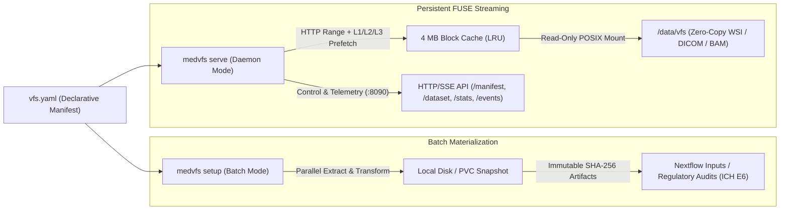
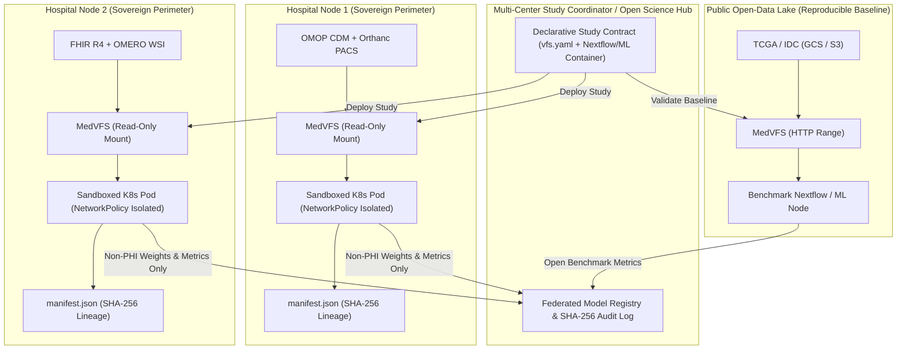

# MedVFS: A Declarative Medical Virtual File System for Federated AI in Biology, Clinical Informatics, and Open Science

**David Olmo Marchal**¹\*, **Lorenzo Olmo Marchal**¹, and **Jose Maria Olmo Millan**¹  

¹ ColabBio Project (`https://colabbio.org`)  
\* Correspondence: `dolmomar@colabbio.org` (`lolmo@colabbio.org`, `jmolmo@colabbio.org`)  

**bioRxiv Category:** Bioinformatics  

---

## Abstract

**Motivation:** Computational biology and clinical artificial intelligence increasingly rely on multimodal cohorts spanning gigapixel whole-slide imaging (WSI), high-throughput genomics, electronic health records (OMOP CDM, HL7 FHIR R4), and hospital PACS/microscopy archives (DICOMweb, OMERO). However, standard bioinformatics orchestrators (e.g., Nextflow) and deep learning frameworks (e.g., PyTorch, OpenSlide) expect local POSIX filesystems, whereas clinical data reside behind heterogeneous, strictly regulated APIs and databases. Conventional extract-transform-load (ETL) pipelines copy sensitive patient data into centralized data lakes, introducing storage duplication, synchronization overhead, and regulatory risk under frameworks such as the General Data Protection Regulation (GDPR).

**Results:** We present **MedVFS** (*Medical Virtual File System*), the Go-based data-plane orchestrator of the **ColabBio** (`colabbio.org`) platform. Guided by the principle *"The data doesn't move; the model goes to the data,"* MedVFS exposes heterogeneous clinical and biological sources as a unified, read-only POSIX filesystem via FUSE (`medvfs serve`) or as deterministic batch snapshots (`medvfs setup`), governed by a single declarative `vfs.yaml` manifest. MedVFS introduces a 4 MB block-based LRU cache, HTTP Range streaming, and a 3-level format-aware prefetch engine (TIFF IFDs, DICOM `PixelData`, BAM headers) alongside an ML Dataset Engine for automated patient linking, deterministic splits, and SHA-256 versioning. In live evaluation on 1.55 GB TCGA-BRCA `.svs` slides, MedVFS achieved a **93.5% cache hit rate** with zero-copy header access. In an end-to-end digital pathology case study (**SlideLab** + Nextflow 25.04.6 + ABMIL), MedVFS enabled on-the-fly streaming that eliminated 5,000–20,000 intermediate tile files per slide (**99.6% storage reduction**), yielded a **3×–4× pipeline speedup**, and achieved **<3 s Kubernetes Pod cold-starts**.

**Availability:** Source code is developed at `https://github.com/colabbio/cb-vfs` (Go module `github.com/colabbio/medvfs`).

---

## 1. Introduction

Modern biomedical discovery sits at the intersection of **AI in Biology**—characterized by multi-gigabyte WSI pathology slides (`.svs`, `.tiff`), aligned sequencing reads (`.bam`, `.cram`), and variant callsets (`.vcf`)—and **Clinical Informatics**, anchored in longitudinal electronic health records (OMOP Common Data Model, HL7 FHIR R4) and clinical imaging repositories (Orthanc DICOMweb, OMERO) [1–4]. Bridging these two domains is essential for precision oncology, biomarker discovery, and real-world evidence (RWE) studies.

In practice, however, data engineering remains a major barrier. Bioinformaticians and machine learning (ML) engineers build reproducible pipelines using Nextflow/`nf-core` [5], OpenSlide [6], and PyTorch, all of which assume POSIX file semantics. Hospital IT environments, conversely, enforce strict perimeter security, data minimization, and access auditing. Centralizing raw Protected Health Information (PHI) into external cloud buckets creates friction with **Data Protection Officers (DPOs)** and **Chief Security Officers (CSOs)** under **GDPR**, while duplicating terabytes of imaging and genomic data saturates storage and network bandwidth.

**Related Work and Positioning:** Existing biomedical data platforms fall into three categories, none of which simultaneously satisfy open-source, on-edge, and multimodal ML requirements (**Table 1**). Centralized Real-World Evidence (RWE) platforms (e.g., Flatiron Health, IQVIA, Aetion, TriNetX) and cloud-hosted health lakes (e.g., BigQuery Health, AWS HealthLake) require hospitals to export patient data off-premise, creating severe GDPR compliance friction and vendor lock-in. Proprietary on-edge platforms (e.g., Palantir Foundry, Rhino Health) preserve local data residency but rely on closed-source stacks with high licensing costs and limited native support for open bioinformatics standards. Finally, open-source federated query networks such as OHDSI/ATLAS [1] and DataSHIELD keep data at the hospital node, but are restricted to distributed SQL or R statistical queries—they cannot orchestrate containerized deep learning workloads or Nextflow pipelines across gigapixel WSI, DICOM, and genomic binaries. Similarly, generic cloud FUSE mounts (`gcsfuse`, `s3fs`) lack biomedical format awareness (TIFF IFDs, DICOM tags, BAM headers) and cannot bridge relational clinical databases (OMOP/FHIR) alongside imaging files. **ColabBio + MedVFS** fills this empty quadrant: an **open-source, on-edge, Kubernetes-native** platform supporting multimodal ML containers.

| Platform Category | Representative Systems | Data Residency | Modalities | Arbitrary ML / Nextflow Containers | Open Source |
| :--- | :--- | :--- | :--- | :--- | :--- |
| **Centralized RWE / Cloud Lakes** | Flatiron, IQVIA, TriNetX, AWS HealthLake | Off-premise (Centralized) | Primarily EHR / Claims | Limited / Cloud-locked | No (Proprietary) |
| **Proprietary On-Edge** | Palantir Foundry, Rhino Health | On-premise (Hospital) | EHR / Imaging (varies) | Vendor-managed sandboxes | No (Proprietary) |
| **Open-Source Federated Query** | OHDSI/ATLAS [1], DataSHIELD | On-premise (Hospital) | OMOP CDM / Tabular | No (SQL / R queries only) | Yes |
| **Open-Source On-Edge Multimodal** | **ColabBio + MedVFS** | **On-premise (Hospital)** | **OMOP + FHIR + WSI + DICOM + Genomics** | **Yes (K8s Sandbox + Nextflow)** | **Yes** |

**Table 1.** Architectural comparison of biomedical and clinical study platforms across data residency, modality coverage, and containerized ML support.

---

## 2. Methods and System Architecture

### 2.1 The `colabbio.org` Ecosystem and MedVFS Data-Plane Role
**ColabBio** (`colabbio.org`) is an open, modular clinical data and biomedical AI infrastructure initiative designed to unify hospital IT environments and reproducible computational science. Rather than requiring centralized data lakes, ColabBio integrates declarative specifications (`cb-specs`), Kubernetes/MicroK8s orchestration (`cb-devops`), Nextflow workflow execution, and **MedVFS** (`cb-vfs`). Within this architecture, MedVFS serves as the **data-plane orchestrator**, abstracting heterogeneous storage protocols so that downstream biological and clinical AI workloads consume data uniformly.

### 2.2 Dual-Mode Execution: `setup` and `serve`
Implemented in Go (`go 1.26.4`) as a single static binary driven by `vfs.yaml`, MedVFS supports two operational modes (**Figure 1**):

1. **`medvfs setup` (Batch Materialization):** Extracts and transforms configured sources into flat files on local disk or Persistent Volume Claims (PVCs). This mode produces immutable, SHA-256-verified snapshots suited for Nextflow inputs and regulatory-grade studies requiring frozen artifacts (e.g., ICH E6, 21 CFR Part 11).
2. **`medvfs serve` (Persistent FUSE Daemon):** Mounts a read-only virtual filesystem (default `/data/vfs`) backed by remote sources while exposing an HTTP/Server-Sent Events (SSE) control and telemetry API on port `:8090` (`/manifest`, `/dataset`, `/stats`, `/events` via `fsnotify`, and `/proxy/{path}` as an HTTP fallback for FUSE-less containers).

**Figure 1.** Dual-mode architecture of MedVFS (`setup` batch materialization vs. `serve` persistent FUSE streaming).

### 2.3 Block-Based FUSE and 3-Level Format-Aware Prefetch
In `serve` mode, remote objects are partitioned into **4 MB blocks** managed by a `BlockManager` with Least Recently Used (LRU) eviction and an `HTTP Range Fetcher` supporting Google Cloud Storage (GCS), Amazon S3, and NFS. To minimize latency during random-access reads typical of biomedical formats, MedVFS implements a 3-level prefetch engine:
- **L1 (Sequential Read-Ahead):** Pre-fetches blocks $N+1 \dots N+3$ during sequential scans.
- **L2 (Format-Aware Prefetch):** Inspects file-open and block-load events to pre-cache structural metadata—specifically **TIFF IFDs** (required for `.svs` WSI pyramids), **DICOM `PixelData` tags**, and **BAM headers**.
- **L3 (Manifest Warmup):** Proactively warms headers of the smallest files at daemon startup to accelerate initial directory and metadata discovery.

### 2.4 Source Adapters, ML Dataset Engine, and Governance
MedVFS provides seven pluggable adapters: `omop` (PostgreSQL SQL-to-CSV), `fhir` (FHIR R4 REST-to-CSV), `omero` (OMERO.web JSON API), `orthanc` (DICOMweb QIDO/WADO-RS), `dicom` (local symlink trees), `genomics` (BAM/CRAM/VCF with index validation), and `files` (1:1 static mapping with glob filters). A **FHIR/OMOP Bridge** injects flattened clinical tables alongside imaging files, while the **ML Dataset Engine** performs cross-source patient linking, deterministic `train`/`val`/`test` splitting, and SHA-256 manifest generation. A **Writable Output Sync** module periodically synchronizes model checkpoints, predictions, and logs back to GCS or S3.

From a governance perspective, MedVFS supports **GDPR** compliance by design: `serve` mode streams only requested byte ranges without copying raw PHI outside the hospital perimeter. **DPOs** gain auditable data provenance through `vfs.yaml` contracts and SHA-256 manifests, while **CSOs** benefit from read-only POSIX mounts, zero temporary PHI dumps, and externalized authentication (**SMART-on-FHIR**, Bearer, Basic, and `k8s://`, `env://`, `file://` secret references). For Kubernetes orchestration, MedVFS ships with a Helm chart supporting `DaemonSet`, `Sidecar`, and `Standalone` modes.

### 2.5 Federated Hospital Networks, Multi-Center Studies, and Open Science
Unlike centralized study platforms that force participating hospitals to upload raw patient cohorts to a third-party cloud, ColabBio and MedVFS execute multi-center studies **at the hospital edge** (**Figure 2**). A consortium or study coordinator distributes a declarative study package—comprising a `vfs.yaml` data contract (with environment overlays for `dev` vs. `prod`) and a containerized Nextflow/ML pipeline. At each participating hospital node:
1. **Local Data Binding:** MedVFS binds to the hospital's sovereign systems (OMOP CDM, FHIR R4, Orthanc PACS, OMERO) using local credentials (`k8s://` or SMART-on-FHIR).
2. **Sandboxed Execution:** The study container runs inside a Kubernetes sandbox with a **read-only MedVFS mount** and strict **`NetworkPolicy` isolation** (preventing outbound exfiltration of raw PHI).
3. **Auditability & EU AI Act Traceability:** MedVFS generates a deterministic `manifest.json` with SHA-256 checksums for every cohort snapshot, providing end-to-end training-data lineage aligned with **GDPR** and **EU AI Act** high-risk medical AI requirements.
4. **Federated Aggregation:** Only non-PHI outputs—such as trained model weights, validation metrics, or summary statistics—leave the hospital perimeter to join the consortium's model registry alongside reproducible benchmarks run on public open-data lakes (e.g., TCGA or IDC on GCS/S3).

**Figure 2.** Federated hospital network topology for multi-center clinical and biological studies using MedVFS and ColabBio, contrasting with centralized data-lake platforms by keeping all raw PHI inside sovereign hospital perimeters.

---

## 3. Results

### 3.1 Live FUSE Mounting and Cache Efficiency
We evaluated `medvfs serve` on a seed cohort (`tcga-brca-seed-vfs`) comprising public TCGA-BRCA whole-slide images (`TCGA-A2-A0T0-01Z-00-DX1.svs`, 1,559,068,211 bytes [1.55 GB]; `TCGA-A2-A0T2-01Z-00-DX1.svs`, 273,678,336 bytes) and `.h5` feature files. Standard POSIX utilities (`ls`, `file`) inspected the virtualized `/tmp/medvfs` mount with zero-copy TIFF header resolution. Live telemetry queried from the `:8092/stats` endpoint recorded **116 cache hits versus 8 misses**, corresponding to a **93.5% cache hit rate** (~32.3 MB fetched/cached) without downloading the full gigapixel slides.

### 3.2 End-to-End Case Study: SlideLab On-The-Fly WSI Streaming and ABMIL
We integrated MedVFS into **SlideLab**, a digital pathology feature-extraction and Attention-Based Multiple Instance Learning (ABMIL) [7] pipeline orchestrated in **Nextflow 25.04.6 DSL2** (`cb-slidelab-abmil/pipelines/main.nf`). The pipeline executes five stages: `SLIDELAB_EXTRACT`, `WRITE_OMERO_ANNOTATIONS`, `ABMIL_TRAIN`, `MLFLOW_REGISTER`, and `TRITON_DEPLOY`.

Using MedVFS POSIX mounts, SlideLab's `StreamingTileDataset` employs lazy OpenSlide C-layer loading to stream tissue tiles directly into RAM/VRAM, apply quality-control (QC) filters (tissue, blur, pen), and encode ResNet50/UNI embeddings atomically into `features.h5`, while persisting QC and PAC metrics back to OMERO as `MapAnnotation` records (`colabbio.ai.slidelab.qc_and_mil`).

| Pipeline Metric | Traditional Disk-Based Workflow | MedVFS + SlideLab On-The-Fly | Observed Improvement |
| :--- | :--- | :--- | :--- |
| **Intermediate tile files / WSI** | 5,000–20,000 PNG/JPEG files | **0 files** (in-memory tensors) | **100% eliminated** |
| **Disk volume written / WSI** | ~2.5–5.0 GB | **~10–20 MB** (`features.h5`) | **99.6% reduction** |
| **Pipeline throughput** | Write-then-read I/O bottleneck | Single-pass memory streaming | **3×–4× speedup** |
| **K8s Pod cold-start** | Monolithic GPU image (~18 GB) | `slidelab:cpu` (~1.2 GB) | **< 3 seconds** |

By eliminating millions of small temporary tile files, the MedVFS–SlideLab integration removes PVC IOPS saturation and filesystem inode locking across multi-worker PyTorch runs.

---

## 4. Discussion

MedVFS demonstrates that unifying **AI in Biology** and **Clinical Informatics** does not require centralizing sensitive patient data or refactoring established bioinformatics software. By pairing format-aware FUSE block streaming with declarative `vfs.yaml` specifications, MedVFS satisfies the operational needs of bioinformaticians while addressing the legal and security mandates of hospital DPOs and CSOs under GDPR.

Current limitations include reliance on privileged FUSE mounts in containerized environments (mitigated via the `/proxy/{path}` HTTP fallback) and static node configuration. Future work will complete a production Kubernetes CSI driver for dynamic multi-tenant volume provisioning, introduce post-materialization Nextflow execution hooks, and expand public health system ingestion adapters to further lower barriers for international open-science consortia.

---

## 5. Code and Data Availability

- **Source Code:** The MedVFS engine (`cb-vfs`, Go module `github.com/colabbio/medvfs`) and ColabBio platform specifications (`cb-specs`, `cb-devops`, `cb-slidelab-abmil`) are developed under the ColabBio organization at `https://github.com/colabbio`.
- **Benchmark Data:** Live FUSE caching benchmarks used publicly available TCGA-BRCA whole-slide images (`TCGA-A2-A0T0-01Z-00-DX1`, `TCGA-A2-A0T2-01Z-00-DX1`) from The Cancer Genome Atlas (TCGA) / Genomic Data Commons (`https://portal.gdc.cancer.gov`).

---

## Author Contributions

MedVFS (`cb-vfs`) is developed as a core component of the **ColabBio** (`colabbio.org`) project. **Jose Maria Olmo Millan** is the Architect of the ColabBio platform, conceiving its federated data-plane model, declarative multi-tenant architecture, and regulatory-by-design approach. **David Olmo Marchal** is the primary implementer of MedVFS, leading the development of the Go FUSE daemon, 3-level prefetch engine, clinical/genomic source adapters, and Kubernetes deployment tooling. **Lorenzo Olmo Marchal** applied and validated ColabBio and MedVFS in his Master of Science (MS) thesis project on **SlideLab**, integrating on-the-fly WSI streaming with ABMIL prediction models.

---

## References

1. Hripcsak G, et al. Observational Health Data Sciences and Informatics (OHDSI): Opportunities for Observational Researchers. *Stud Health Technol Inform*. 2015;216:574–578.
2. HL7 International. Fast Healthcare Interoperability Resources (FHIR) R4 Specification. `https://hl7.org/fhir/R4/`.
3. Allan C, et al. OMERO: flexible, model-driven data management for experimental biology. *Nat Methods*. 2012;9(3):245–253.
4. Jodogne S. The Orthanc Ecosystem for Medical Imaging. *J Digit Imaging*. 2018;31(3):341–352.
5. Di Tommaso P, et al. Nextflow enables reproducible computational workflows. *Nat Biotechnol*. 2017;35(4):316–319.
6. Goode A, et al. OpenSlide: A vendor-neutral software foundation for digital pathology. *J Pathol Inform*. 2013;4:27.
7. Ilse M, Tomczak J, Welling M. Attention-based Deep Multiple Instance Learning. *Proc ICML*. 2018;80:2127–2136.
